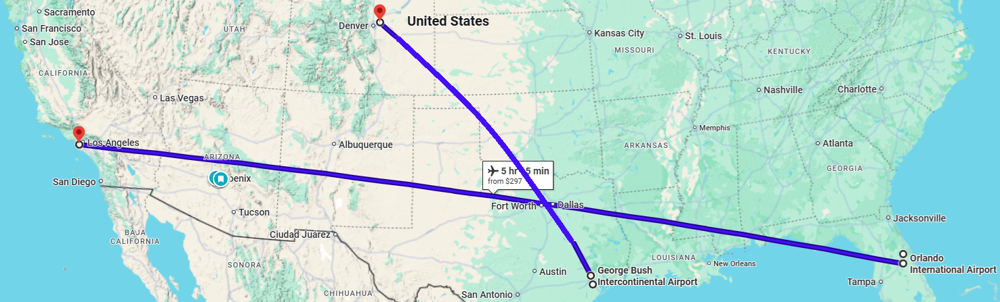

# Experiment definition (one page)

**Status: draft, nothing decided.** Drafted by Claude on 2026-10-06 from the 2026-10-04 and 2026-10-05 journal discussions, at the owner's request. Every item marked **Decide** is the owner's call; the option written down is a proposal. Not report text.

## 1. Central claim (decided 2026-11-08, D-042)

**Decided (owner, 2026-11-08):** the objectives, requirements and interfaces established by the literature show that the information is insufficient. Resolving a conflict with regard to its impact on every aircraft involved needs information that does not reach ATC: there is no extended projected profile in the NAS, the manufacturers provide no performance models, and the AOC provides no API to its models. Case A is what ATC has and uses today, so its decision is suboptimal. Decomposing the requirement to consider impact (SLR-CLR-13 into HLR-ATC-10, HLR-ATC-11 and HLR-ATC-05) leaves several ways to meet it, at different fidelity and impact; comparing them (cases A to D, the means of D-022) is the study. The model's part is the trace from objective to requirement to the missing interface, and the decomposition that turns one requirement into alternative means. Checking other decisions in the model the same way has value but is not the main claim; fuel load is the first candidate, if time (`to-do-list.md` Track B).

*Earlier proposal, kept for the record (superseded by D-042):*

**Proposed:** the architecture model can be checked, decision by decision, for one thing: does the actor who makes this decision receive the information the decision depends on? The experiment measures what one of the gaps found by that check costs. It is one worked example, not the main result.
    - OOK, 10/29/2026, This will be the main claim. It seems feasable. Objective -> Requirement -> Activity Diagram -> Sequence Diagram -> exchanges w/or w/o info
                                                                        |               |                   |                   |                           |
                                                               (from stakeholders)   (for objectives)  (Nominal Ops)    (conflict resol.)       (controller w/o GW, ACM)

**Alternative:** the four-aircraft experiment is the main result. This is weaker for three reasons. The expected effect is small (about 27 gallons and 2.3 minutes per flight for the typical case, a switch to a more wind-optimal trajectory, in NASA's TASAR study; the three cases range from 12 to 103 gallons: `engility2014tasarAlaska`, p. 12). The value of sharing aircraft data with ATC has already been studied (Coppenbarger; SESAR's downlink of the aircraft's predicted profile). And the simulation compares two ways of operating, so it cannot test MBSE as an engineering method.

**What the proposed claim lets the project say about MBSE:** the benefit is any gap the check finds that the owner did not already know. The cost is the modeling time recorded in the journal and git history. If the check finds nothing new, the claim is the modest one: the model organized existing knowledge.

## 2. The gap being measured

An en-route sector controller resolves a crossing conflict between two aircraft in level cruise. Whether to climb or descend, and which aircraft to move, depends on each aircraft's weight. The controller does not receive weight or cost index (`schultz2012adaptiveClimb`, p. 2); the ground system assumes one nominal weight per aircraft type (`coppenbarger1999climbPrediction`). The airline and the FMS have the weight but not the authority.

## 3. Scenario

Four aircraft in one invented sector, shown as a single snapshot: one crossing pair, and two aircraft in trail that block some level changes. Two of the four belong to the same airline, one late with connections and one early. Weights are spread using the published 4.5 to 7 percent standard deviation of take-off weight. Each case picks from a short list of discrete maneuvers by enumeration; there is no solver.

The scenario makes a lot of sense to me:

## 4. The one thing that differs

What the decider knows. The available maneuvers (altitude, vector, speed) are the same in every case.

- **A:** rule-based decision with today's information.
- **B:** automated decision with a nominal aircraft model.
- **C:** automated decision with shared weight and cost index.

B against A is the value of automation. C against B is the value of the information exchange, which is the architecture claim.

## 5. Baseline rule

One descent clearance. This is the most common observed choice for this geometry: 23 of 36 cases in `rantanen2012conflictManeuvers`.

- **Which aircraft descends (Decide).** Proposed: leave the aircraft in steady state alone and move the one that already needs something (`kirwan2001coraStrategies`). If both are in steady cruise this rule does not choose, so a second rule is needed. Candidates are the published resolver tie-breakers (farthest from top of descent; not recently maneuvered).
    - OOK, 10/29/2026, Let's assume that AC3 & AC4 are closer to AC1 laterally than would be permitted if they were at the same flight level, so the aircraft that has to descend is AC2.
- **After the descent (Decide).** Proposed: the aircraft is cleared back up later, counted as a second instruction.
    - OOK, 10/29/2026, Yes, they need to re-climb. If they're going to Denver and this occurs somewhere in Texas, they'd want to get cleared to a more optimal altitude b/c they're only about 1/3 through the flight

## 6. Metrics

- Airline cost per aircraft: fuel plus time weighted by cost index (`mori2022massCruise`, Eq. 1–3).
- Controller workload: instructions issued plus follow-ups.
- Separation: a hard constraint, not a score.

Each option is scored at four levels (aircraft, airline, sector, system) in one table, with the largest penalty taken by any one aircraft reported alongside.

A draft of that table, the list of resolution options it scores, and one cost/benefit statement per level are in `experiment-options-and-scoring.md` (2026-10-09, from the owner's hand review; nothing in it is decided).

## 7. Truth model (decided 2026-10-10, D-017)

One model scores every case, at higher fidelity than the model any case used to decide. **OpenAP** (`sun2020openap`) supplies fuel flow, thrust and drag as functions of mass, speed and altitude for the B737-9, at three selectable fidelities (`conceptual`, `nominalMass`, `actualMass`). Implemented in `projects/nas-sos-capstone/simulation/experiment_scoring.py`; scenario numbers in `experiment-scenario-numbers.md` and `simulation/scenario_base.yaml`; model-side declaration in `cameo_models/nas_analysis.sysml`. The earlier `simulation/vehicle_dynamics.py` (constant fuel flow) is not used. First run 2026-10-10: case A descends the heavy aircraft 4,000 ft; cases B, C and D all pick the 2,000 ft descent with the in-trail aircraft slowed, so in the base scenario sharing weight and cost index did not change the choice. See `experiment-options-and-scoring.md` §8.

## 8. Possible results

1. Same answer as the baseline: the information is worth nothing here. One such case is included on purpose (similar weights and cost indexes). **Changed 2026-10-11 (D-024):** similar weights alone no longer give this result. Case C knows the weight, so the FL350 climb rule does not bind it, and at 67,000 kg it climbs where case B cannot. The "worth nothing" case is now similar weights with the level above occupied; see the third run in `experiment-options-and-scoring.md` section 8.
2. Descend the other aircraft: lower cost at the same workload. The strongest result.
3. A different maneuver: lower cost, more workload.

## 9. Two checks before building anything

- **Effect size.** Rough first pass, by Claude, to be verified: `mori2022massCruise` reports about 1,000 ft of optimum altitude per 20,000 lb for a B787-8, which is roughly 4 to 5 percent of its weight. Two aircraft of one type at one standard deviation above and below the mean differ by 9 to 14 percent, so their optimum altitudes would differ by roughly 2,000 to 3,000 ft. That is more than one flight level, so the better aircraft to descend can plausibly change with weight. This assumes the B787 relation carries over to other types by percentage, which is unchecked, and it says nothing yet about how many pounds of fuel the wrong choice costs.
    - **Done (owner, 2026-11-08).** The runs answered whether the choice changes: in the sixth run (2026-11-10, D-047) case B moves AC2 down 4,000 ft like case A (+41.2 kg) and case C climbs AC2 2,000 ft (+12.4 kg), so C − B = −28.8 kg; knowing the weight opens the climb above FL350 (D-024). The fifth run's C − B of −19.9 kg rested on case B picking AC1's descent, which passes AC3 too closely and was a tie broken by list order (D-047). The owner's O4 hand check (2026-11-07, `simulation/debug_o4_walkthrough.py`) confirmed the arithmetic. OpenAP's own accuracy is not validated (D-038); how large the gap is against the scoring model's error goes into the "sufficiently accurate" discussion.
- **The check by hand** on three or four decisions already in the context diagram. Not done. The owner should do it, because the test is whether it turns up something the owner did not already know.
    - **Done for the studied decision (owner, 2026-11-08).** The objectives, requirements and interfaces established by the literature show that the information is insufficient: resolving a conflict with regard to its impact on every aircraft involved needs information that does not reach ATC (no extended projected profile in the NAS, no performance models from the manufacturers, no interface from the airline operations center carrying its models). Case A is the decision as made today, so it is suboptimal whatever the rule. Decomposing the requirement to consider impact leaves several ways to meet it, at different fidelity and impact; that is what the study compares. Applying the check to other decisions has value; fuel load is the first candidate (if time, `to-do-list.md` Track B).

## 10. Known limits

- Level crossing conflicts are a minority: 36 of 256 in the U.S. data.
- Cost index understates a connection-critical flight, and dispatchers rate schedule integrity and connections above fuel (Sheth, Gutierrez-Nolasco, Courtney and Smith, credits-concept paper, Figure 7, PDF p. 11; held in `evidence/sources/` but not yet registered; the paper says the averages are not statistically significant).
- Airlines could misreport what they share. Published gains from misreporting cost index are small (1 to 3 percent).
- The ±0.04 M speed figure is still unsourced.
- Flight-path angle (found 2026-11-07, O4 walk-through): OpenAP takes γ = atan(vs / TAS), treating TAS as the horizontal side; TAS lies along the path, so the exact angle is asin(vs / TAS). For O4's climb the difference is 0.00002° and 0.001 kg of fuel. Negligible; stated so a hand check does not trip on it. In the report: `\plantodo` after the simplifications list in `report/sections/05_experiment.tex`.
- Round trip costed one way (found 2026-11-07, O4 walk-through; the owner's `#TODO` in `maneuver_cost`): in the default setting a descent's climb back is costed (O8, O10), a climb's descent back is not (O4). With `stay_at_new_level: if_better` (D-041) a climb to a worse level comes back and the descent is costed; in this scenario every climb is to a better level, so the aircraft stays. Same `\plantodo`.
- Fuel flow depends on thrust alone (2026-11-07, D-041): OpenAP's fuel flow has no altitude or Mach term, so every difference between levels is aerodynamic (lift coefficient toward its best lift-to-drag value, 0.69, and lower drag); a real engine's fuel per unit thrust also changes with altitude. Best level for fuel per mile at Mach 0.80: FL410 (AC1), FL430 (AC2), above what each can hold with 150 ft/min left. In the report: AI-drafted item in the simplifications list, `report/sections/05_experiment.tex`.
- The benefit of staying at a better level after the hold is not counted (D-041): reported in the level-check table (Table 9); for this scenario's AC2 about 39 kg over 61 minutes. Table 8 is conservative for cases C and D.

## 11. For the adviser

- Which scope option (a, b or c)? This design sits near (b).
- What is the current-state metric?
- Is "one measured example under a model-wide check" an acceptable central claim for the capstone?
