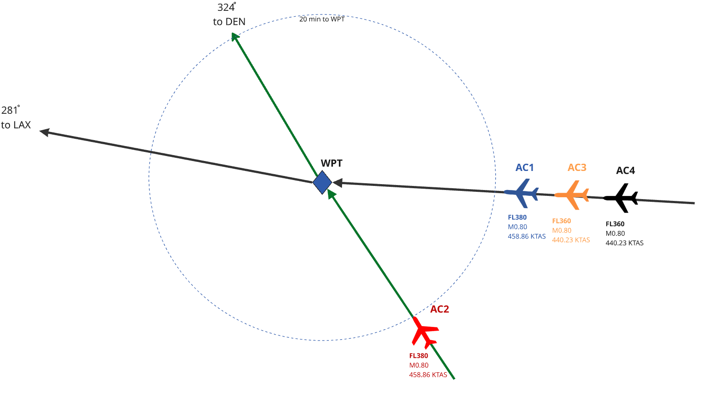
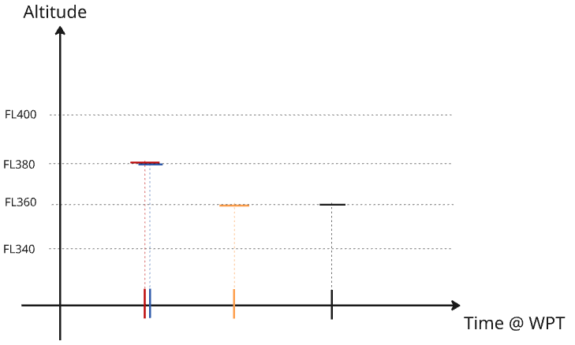

# Journal — 2026-10-11

## 09:40 — Welcome

**Recap:**

- Turn 1 of the nine-turn plan (Oct 10 to 18). Interim Report #2 is due Sun 2026-10-25.
- In flight: the requirements set (two hand reviews done, see the entry below); the experiment's scenario numbers, still unconfirmed, with a first run in which sharing weight and cost index changed nothing; the Assumptions and Methodology section, not drafted.
- Nothing from 2026-10-10 is committed. The first two requirements drafts exist only in the two marked-up PDFs under `projects/nas-sos-capstone/handwritten/`.

**Diagrams:** `tools/render_sysml_diagrams.py` ran after the requirements edits; the model checks clean and all five views were unchanged, so the report was not recompiled. Syside printed one warning (a raster was downscaled to fit memory).

**Focus picks (Professor):**

1. Put a criterion on workload. SN-ATC-04 is back and SLR-CLR-15 says "within what the sector team can sustain", with no number and no source for one. Until there is a criterion, the experiment's instruction count is a measurement with nothing to compare it to.
2. Write the next tier for the thread. After two rounds of cuts the two statements the project rests on are "the information needed to preserve safety and pursue optimality" (SLR-INF-02) and "lowest impact" (SLR-CLR-13). Neither can be checked as written. The next tier is where weight, cost index and connection priority reappear as checkable statements, and it is the worked example of tiering the report needs by 2026-10-25.
3. Confirm the scenario numbers in `knowledge/models/experiment-scenario-numbers.md`. This was yesterday's first next step and is still open; every result depends on it.

## 09:40 — Second hand review of the requirements applied (D-021)

**What was worked on and why:** the owner marked up the second print of `knowledge/models/requirements-and-traceability.md` (`projects/nas-sos-capstone/handwritten/2026-10-11_requirements-and-traceability_v2.pdf`) and asked for the changes to be incorporated.

**What changed** (not committed):

- `decisions/decisions-log.md`: D-021.
- `cameo_models/requirements_stakeholders.sysml`: 13 requirements (was 12). SN-ATC-04 restored; "at its lowest operating cost" struck from SN-AIR-01; the owner's note on SN-AIR-03 recorded in its rationale; "owner to confirm" removed where the owner ticked the item.
- `cameo_models/requirements_nas_system.sysml`: 23 requirements (was 28). Struck: SLR-PLN-03, SLR-PLN-08, SLR-FLW-03, SLR-CLR-12, SLR-INF-06, SLR-APT-02. Re-worded: SLR-CLR-04, SLR-CLR-13, SLR-EXE-02, SLR-EXE-03, SLR-EXE-06. New: SLR-CLR-15, written by Claude so the restored SN-ATC-04 has an answer. The traffic flow management package is gone.
- `cameo_models/nas_verification.sysml`: the instruction-count case now verifies SLR-CLR-15; the lowest-cost case is renamed for lowest impact.
- `knowledge/models/requirements-and-traceability.md` regenerated; #TODO items (a) to (c) ticked as on the print; section 7 rewritten to hold only what is new.
- Counts corrected in `cameo_models/sysmlv2_exploration.md`, `task-board.md`, `to-do-list.md` and `knowledge/questions/open-questions.md`.
- Checks: `syside check` reports "All checks passed!".

**For the owner:** SLR-CLR-15 is not the owner's wording. SN-AIR-03 is now answered only by the arrival-estimate update (SLR-INF-07). SN-CRW-07 still names traffic management initiatives. All three are in section 7 of the traceability file.

## 10:15 — Constituent system requirements drafted (D-022)

**What was worked on and why:** the owner took the scenario numbers for review and asked Claude to author the next level of requirements: every constituent system allocated requirements, traced to the system requirements, each stating its objective, with rule of thumb, low fidelity and high fidelity listed as separate means of achieving it and scored in the experiment. The owner also answered three open points from the morning.

**What changed** (not committed):

- `decisions/decisions-log.md`: D-022.
- New `cameo_models/requirements_constituent_systems.sysml`: 28 requirements with a constituent system as the subject (flight crew 5, flight operations 7, air traffic control 9, aircraft 5, airport operations 2). HLR-CRW-01 is the owner's sentence; the rest are Claude's. Every one of the 23 system requirements has at least one under it.
- `cameo_models/requirements_definitions.sysml`: `MeansOfAchievement` (rule of thumb, low-fidelity model, high-fidelity model, high-fidelity model plus connections: experiment cases A to D) and `ConstituentSystemRequirement`.
- `cameo_models/nas_verification.sysml`: twelve verification cases, one per means, for HLR-ATC-04 (flyable clearance), HLR-ATC-05 (lowest impact) and HLR-ATC-06 (workload).
- Owner's answers applied: the note under SLR-PLN-05 now says "DES" is descent and gives the reasoning (a descent can always be achieved; a climb cannot be assumed); SLR-CLR-04 also answers SN-AIR-03, since the crew and dispatchers coordinate; SN-CRW-07 reads "weather, traffic and other safety considerations".
- `knowledge/models/requirements-and-traceability.md` regenerated, with the new tier as section 11.
- One-line updates in `cameo_models/sysmlv2_exploration.md`, `to-do-list.md` and `task-board.md`.
- Checks: `syside check` reports "All checks passed!". `simulation/experiment_scoring.py` was not changed and not re-run.

**For the owner:** the list "Things to check in this draft" at the end of section 11: airport operations is a thin fit; whether case D is a fourth means or a variant of the third; whether the flight management system sends its figures to the airline today; six requirements graded [SME]; the flight planning means are not scored.

## Envelope figure redrawn for the heavy aircraft

**What was worked on and why:** the owner asked for the flight envelope figure to be regenerated for the heaviest aircraft weight, to show how little room it has to manoeuvre inside its envelope.

**What changed** (not committed):

- `simulation/b739_envelope.py`: `figure_envelope` rewritten. It now draws only the heavy aircraft (AC1, 74,200 kg) from FL310 to FL420. Left panel: the usable region shaded, the three limits, the aircraft's present point (FL380, Mach 0.80), and the five instructions `scenario_base.yaml` offers it, each marked as inside or outside the envelope. Right panels: width of the usable speed band and rate of climb left at Mach 0.80, by flight level. The light aircraft is no longer on this figure; it is still on `b739_fuelflow_altitude.png`, which was regenerated unchanged.
- `report/figures/b739_envelope.png` regenerated. Numbers the script prints: no level flight above FL389; usable speed band 114 kt at FL340 and 77 kt at FL380; rate of climb left 349 ft/min at FL340 and 70 ft/min at FL380. The climb to FL400 and the +0.04 Mach speed-up are outside the envelope; the −0.04 Mach slow-down and both descents are inside.
- `report/sections/04_results_discussion.tex`: the placeholder caption of the envelope figure updated to describe the new figure. Still marked PLACEHOLDER; the caption is the owner's to write.
- Checks: the 14 tests under `simulation/` pass. The report was not recompiled.

**For the owner:**

- The ceiling reads FL389 here and FL385 on the old figure. Same model; the old figure stepped altitude by 500 ft and this one by 100 ft.
- The low-speed limit still rests on the assumed CLmax of 1.45 [C], so the 77 kt and 114 kt widths are only as good as that number. The climb limit does not depend on it.
- "Rate of climb left" uses OpenAP's maximum cruise thrust, not climb thrust, to stay consistent with the ceiling line. It understates what the aircraft could do at climb rating.
- The figure starts at FL310 because OpenAP's cruise thrust steps at 30,000 ft, which puts a jump in the climb-rate curve there.

## scenario numbers review

## Traceability file cut down and ownership marked

**What was worked on and why:** the owner asked for `knowledge/models/requirements-and-traceability.md` to reflect the two hand reviews, to say plainly who owns each part, and to lose what is only review history.

**What changed** (not committed; only this file and the traceability file):

- New "Who wrote what" table at the top, and a Wording column on every stakeholder and system requirement: Owner (6), Owner edit (10), Claude, kept (19), Claude, unreviewed (1: SLR-CLR-15). Assigned by Claude from the notes of the two hand reviews; the owner should correct any that are wrong.
- Section 11 (the 28 constituent system requirements) is unchanged: Claude's draft, not reviewed, HLR-CRW-01 the owner's sentence.
- Section 7 now holds only the four things Claude added after the second print that the owner has not seen: SLR-CLR-15, the measure on SLR-CLR-13, the allocations and `baseline` tag on SLR-EXE-03 and SLR-EXE-06, and the SLR-CLR-04 to SN-AIR-03 trace link.
- Section numbers are the same as before, because `decisions/decisions-log.md` and the `.sysml` headers cite sections 6, 7, 9 and 11.
- No `.sysml` file was touched. The requirement sentences in the file still match the model word for word (checked by script). `syside check` was not re-run.

**Removed from the file, and where it still is:**

- The three tables in section 6 listing every struck requirement with the owner's handwriting quoted (17 stakeholder, 31 system). Replaced by a summary by reason. Full tables: `git show 43a454d:knowledge/models/requirements-and-traceability.md`, and the two marked-up PDFs in `projects/nas-sos-capstone/handwritten/`.
- The review history in each note ("struck by the owner on 2026-10-10", and so on). Still in the `rationale` attribute of each requirement in the `.sysml` files.
- The first-draft counts, the ticked #TODO items (a) to (c), and the lists in section 9 of what was and was not carried over from the two prework workbooks. Same commit.

**For the owner:** the #TODO list at the top of the traceability file now has four items: review section 11, review section 7, name a verification case for each requirement on the thread, and confirm three unconfirmed items (the 45-minute reserve, the separation minimum, the low-fuel alert to controllers).

## Service ceiling applied to the envelope and the scenario weights (D-023)

**What was worked on and why:** the owner checked in `evidence/sources/AC_61-107B_CHG_1_FAA.pdf`, pointed out that an aircraft must have 100 ft/min of climb left at its service ceiling and that many airlines keep 150 ft/min, and asked for the source to be processed, the envelope script updated, and the Mach numbers or weights changed to fit.

**What changed** (not committed):

- Source processed: bib entry `faa2015ac61107b`, summary `evidence/literature-notes/summaries/3 - faa2015ac61107b.md` (rated 3), ledger row in `evidence/source-register.md`. Skimmed: definitions and the Mach-flight chapter read, the rest searched by keyword. "Service ceiling" and "coffin corner" added to `knowledge/concepts/glossary.md`.
- `simulation/b739_envelope.py`: draws the lines of 0, 100 and 150 ft/min of climb left; the shaded usable region and the "can fly / outside the envelope" marks now use 150 ft/min, read from `scenario_base.yaml`.
- `simulation/scenario_base.yaml`: `min_climb_rate_ft_min: 150`; nominal mass 67,000 kg (was 70,000), AC1 71,020 kg (was 74,200), AC2 62,980 kg (was 65,800), AC3 and AC4 67,000 kg. Mach 0.80, FL380 and the ±6 percent spread unchanged.
- `simulation/experiment_scoring.py`: the "can it hold this level" test uses the same 150 ft/min. `test_experiment_scoring.py`: the asymmetry test now checks against that margin.
- Regenerated: `report/figures/b739_envelope.png`, `b739_fuelflow_altitude.png`, the three tables under `report/figures/tables/`, `cameo_models/results/experiment_results.sysml`.
- `decisions/decisions-log.md` D-023; `knowledge/models/experiment-scenario-numbers.md`; `knowledge/models/experiment-options-and-scoring.md` section 8 (second run added under the first); the placeholder caption in `report/sections/04_results_discussion.tex`.
- Checks: 14 tests pass; `syside check` reports "All checks passed!". The report was not compiled by Claude.

**Numbers the script prints for the heavy aircraft at 71,020 kg:** no level flight above FL401; service ceiling (100 ft/min) FL390 at the best speed, FL389 at Mach 0.80; 150 ft/min left up to FL385 at the best speed, FL383 at Mach 0.80; usable speed band 85 kt at FL380; climb left at FL380 181 ft/min. The climb to FL400 and the +0.04 Mach speed-up are outside; the slow-down and both descents are inside.

**For the owner:**

- **The experiment's answer changed.** Cases C and D now pick the light aircraft's climb (O4); in the first run they picked the same option as case B. O4 beats B's option by 0.1 kg of fuel, which is inside the model's error; the solid difference is one instruction now and one later against two and two, and that airline Y pays where airline X did. See section 8 of `knowledge/models/experiment-options-and-scoring.md`.
- The new weights are Claude's recommendation, applied. They are the owner's to confirm (D-023 item 3).
- 150 ft/min has no document behind it; it is recorded as [SME]. The circular gives only 100 ft/min.
- Correction to the note in the envelope entry above: OpenAP's climb thrust and maximum cruise thrust are the same number at these levels (checked at FL360, FL380, FL400), so the climb-left figures are not understated for that reason.
- `report/main.pdf` shows as modified and changed size twice during this session. Claude did not compile it; it looks like an editor auto-build.

## Placeholder write-up of the scoring method; smoke script on the new weights

**What was worked on and why:** the owner asked for a placeholder write-up of the methodology with equations, citing the equations of motion the Python package uses, and for `simulation/openap_smoke.py` to reflect the new weights.

**What changed** (not committed):

- `report/sections/03_assumptions_methodology.tex`: new subsection "Scoring Model Calculations" (label `sec:scoring-method`), marked PLACEHOLDER and AI-drafted. Sixteen numbered equations: the point-mass equations of motion, true airspeed, OpenAP's drag polar, maximum thrust and fuel flow, climb left and the level test, the cost of each manoeuvre, the cost each case minimises; a table of the values OpenAP holds for the type; a worked example of option O4 (13.0 kg, matching the options table); seven limitations.
- `evidence/sources/references.bib`: `bartel2008thrustFuel` added (the thrust model OpenAP implements). Not held, not read; volume, pages and DOI entered from memory and flagged in the entry.
- `simulation/openap_smoke.py`: reads the light, nominal and heavy weights and the climb margin from `scenario_base.yaml`, prints climb left in each cell, and flags a level with less than the margin.
- `knowledge/questions/open-questions.md`: one item added (the 1,500 ft/min climb, below).
- Checks: the report compiles with no undefined references or citations (a first run failed on a missing biber file, most likely a clash with the editor's own build; the second run was clean). 14 tests pass.

**For the owner:**

- **The climb in option O4 is costed at a rate the model says the aircraft cannot fly.** 1,500 ft/min needs about 56 kN at FL390; the thrust model gives 42 kN, which is about 400 ft/min. That climb term is what decides O4 against O9 (0.1 kg apart). This needs a decision before the second-run result is used.
- OpenAP's drag has no Mach-number term (its wave-drag option is off by default and marked experimental), and its fuel curve for this type is the package default scaled by the LEAP-1B take-off fuel flow.
- The OpenAP equations were read from the package source (version 2.6.2), not from the journal paper, which is still unread. The write-up is the owner's to check and rewrite.

## Climb rate fixed; compressibility assumption stated (D-024)

**What was worked on and why:** the owner chose the slower climb at maximum thrust, asked for the paper number of Bartel and Young (2008), and asked for the no-compressibility assumption to be mentioned, noting that the FAA circular starts the transonic range at Mach 0.75.

**What changed** (not committed):

- `simulation/experiment_scoring.py`: a climb is flown at the rate maximum thrust allows at its mid-altitude, capped at 1,500 ft/min (new `Performance.climb_rate_fpm`). Tables and `cameo_models/results/experiment_results.sysml` regenerated.
- `report/sections/03_assumptions_methodology.tex` (placeholder subsection): the climb-rate equation added, the worked example redone (12.4 kg), the compressibility assumption stated with the circular's ranges, the limitations list revised.
- `evidence/sources/references.bib`: `bartel2008thrustFuel` corrected. Journal of Aircraft, vol. 45, no. 4, pp. 1450 to 1456 (confirmed against the University of Limerick repository). The DOI first entered from memory was wrong; it is now 10.2514/1.34351, taken from another paper's reference list, not the publisher's page.
- `decisions/decisions-log.md` D-024; third run in `knowledge/models/experiment-options-and-scoring.md` section 8; `knowledge/questions/open-questions.md` (one item closed, two added).
- Checks: 13 tests pass, 1 fails (below). Report compiled.

**Results of the third run:** A O8 +32.0 kg; B O9 +16.0 kg; C and D O4 +12.4 kg. C beats B by 3.6 kg and two calls (second run: 0.1 kg).

**For the owner:**

- **Compressibility is small in drag and not small in climb margin.** With OpenAP's experimental wave-drag term on, drag at Mach 0.80 is 2 to 4 percent higher. The heavy aircraft's climb left at FL380 falls from 181 to 93 ft/min, under the service-ceiling 100. The weights of D-023 hold only with the term off. Not changed; a decision is needed.
- **`test_similar_weights_variation_makes_c_match_b` fails and was left failing.** With both aircraft at 67,000 kg, case C picks a climb and case B cannot offer one. Knowing the weight is what matters, not the weights differing. The check needs restating or the finding needs keeping.

**Correction (owner, same day):** the DOI 10.2514/1.34351 recorded above for `bartel2008thrustFuel` resolves to a different article (Kim and Choi, formation flight). It has been removed from the bib entry; the entry now has no DOI and says so. Volume, issue and pages stand.

**Second correction (same day):** the DOI of `bartel2008thrustFuel` is 10.2514/1.35589 (supplied by the owner). Its Crossref record matches the authors, title, journal, volume 45, issue 4 and pages 1450 to 1456. The bib entry is updated.

## Similar-weights test replaced by two

**What changed** (not committed): `simulation/test_experiment_scoring.py`: `test_similar_weights_variation_makes_c_match_b` removed at the owner's direction and replaced by `test_similar_weights_same_numbers_for_every_option` (with equal weights, the nominal-mass and actual-mass scores agree on fuel, time and feasibility for all nine options) and `test_similar_weights_with_the_climb_closed_c_matches_b` (with FL400 occupied, case C picks case B's option; with it open, case C picks a climb that case B may not offer). 15 tests pass. One sentence amended in `knowledge/models/experiment-definition.md` section 8; the open question is closed.

