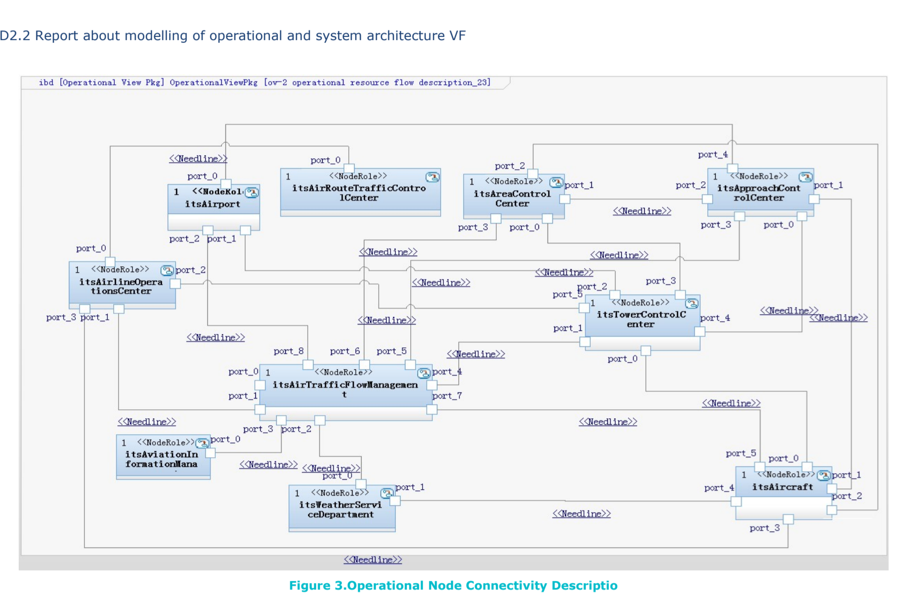
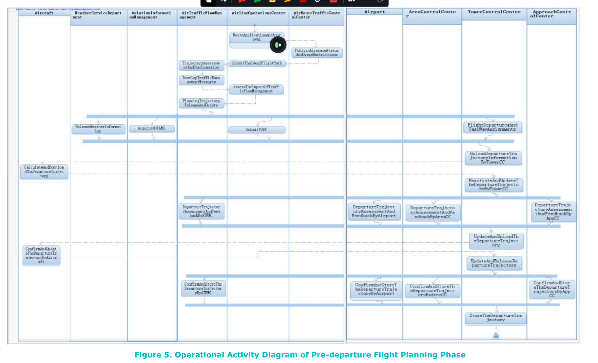
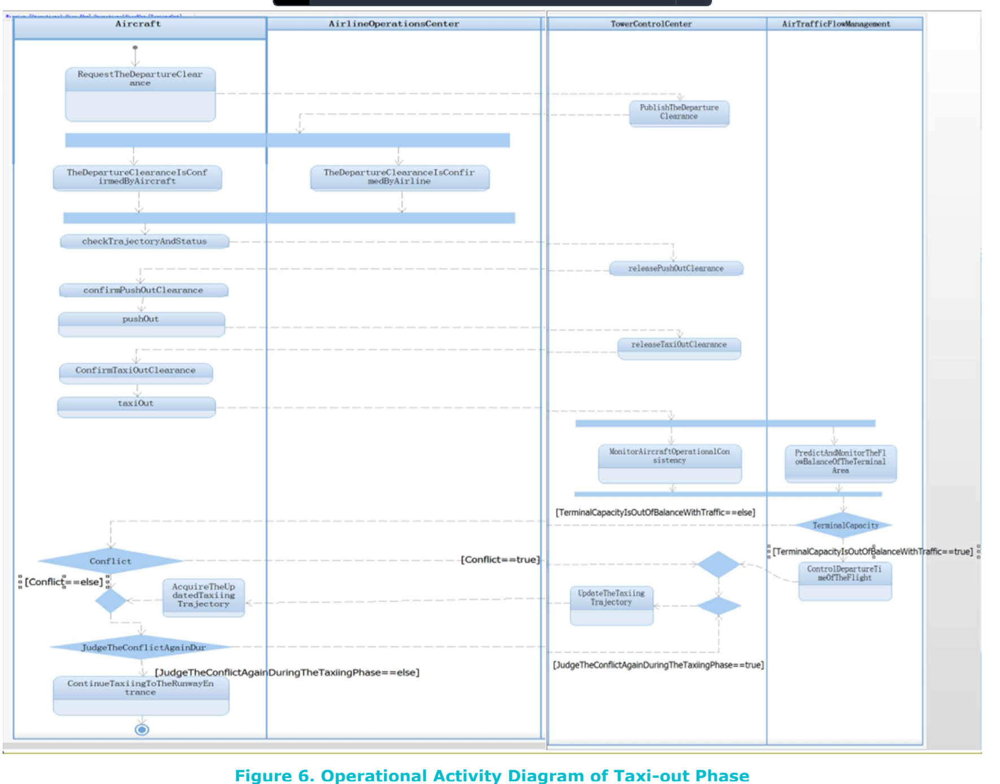

# Journal — 2026-10-14

## 19:55 — Welcome

**Recap:**

- Turn 1 of the nine-turn plan (Oct 10 to 18) ends Sunday. Interim Report #2 is due Sun 2026-10-25, eleven days out.
- In flight: the report after two hand reviews (twelve passages marked blue for the owner to rewrite); the experiment's scenario numbers, still unconfirmed; the requirements' open `#TODO` items. Working tree clean; last commit dcd2f7e.
- Unresolved from 2026-10-11: whether to turn on OpenAP's compressibility drag (with it on, the heavy aircraft drops under the 100 ft/min service-ceiling margin at FL380).

**Diagrams:** `tools/render_sysml_diagrams.py` ran; model checks clean, all five views unchanged. Syside printed the usual raster-downscale warning. The report was recompiled at the owner's request (forced full rebuild): 43 pages, no errors, no undefined references or citations.

**Focus picks (Professor):**

1. State the two claims at the top of the Introduction and the central claim at the top of Section 3. Still unanswered after two reviews; the review the owner is about to do should read the report against them.
2. Decide the compressibility question before writing any discussion under the outcome table. The source paper says not to ignore it, and switching it on changes the weights and may change the result.
3. Confirm the scenario numbers (`knowledge/models/experiment-scenario-numbers.md`). Open since 2026-10-10; every number in Section 4 rests on them.

## Sources with models

## 21:44 — Sign-Off

**What was worked on and why:** The owner wrote the literature review in Section 1 (Introduction) of the report, in `report/sections/02_introduction.tex`, in their own words. It replaces the `\plantodo` scaffolding (the §2 to §4 synthesis prompt, the research-gap placeholder, and the four §11 context placeholders) with prose. The prose sorts the sources into three groups (long-horizon airline planning, day-of-operations coordination, tactical execution and disruption). It says that few sources model the problem with systems engineering; Liu 2025 and GREAT are the closest. It names the gap this project fills, as three bullets. It then folds in the controller-behaviour (Rantanen) and TASAR points as prose. The owner also stated the two claims near the top of the Introduction, which partly answers this evening's Professor focus pick 1. The owner also added a wake-turbulence assumption to Section 3 (`03_assumptions_methodology.tex`) and turned on soft wrap in `.vscode/settings.json`. Three example figures (`attachments/*_china_example.png`) went into this journal under "Sources with models".

**What changed:**

- `02_introduction.tex`: literature review and research gap written by the owner; two claims stated; header comments and the Interim Report #2 `\irtwo` call-out for the Introduction removed.
- `03_assumptions_methodology.tex`: new assumption that wake turbulence is not modeled.
- No to-do boxes checked. The Section 1 line in `to-do-list.md` stays open: the claims are not yet in the Executive Summary, and the Claude-drafted passages, the scope reasons, the deliverables table and the timing subsection are still open. No decisions logged; the prose is the owner's, and it did not change the scope or the architecture.

**Blocked / problems found:**

- **Undefined citation:** `\cite{great2023}` (line 59) has no entry in `references.bib`; the last build's log shows it undefined on page 5. The bib holds `great2020d21tboConcept`, `great2021d22operationalArch` and `great2021d51avionicsArch`. The owner needs to say which document "page 37" refers to, or add the missing one per the source workflow.
- The emissions-sources placeholder was deleted from the Introduction along with the others. The need is still tracked in `to-do-list.md` ("Sources still needed for the experiment"), so nothing is lost.
- The report PDF has not been rebuilt since the edit was finished; rebuild after the citation fix.

**Did anything change how the work should be done?** No.

**PM status check:**

- *Verdict:* on track for Turn 1, but Turn 1 ends Sun 2026-10-18 (four days away), and two of this evening's three focus picks are still open.
- *Due or at risk in the next 7 days:* the Turn 1 exit test needs Assumptions and Methodology drafted. The scenario numbers (`experiment-scenario-numbers.md`) are still unconfirmed, open since 10-10; every number in Section 4 depends on them, and this is the biggest risk to Interim Report #2 (due 10-25). The compressibility decision is still open and comes before any discussion of results.
- *Slipped:* nothing new. The scenario numbers have now been carried over four days.
- *Recommended action:* fix the citation, then spend the next session on the scenario numbers and the compressibility decision before more prose.

**Next steps:**

1. Owner: fix `\cite{great2023}` (choose the right GREAT deliverable or add the source), then rebuild the report (`compile-report`).
2. Owner: confirm or change the Decide items in `knowledge/models/experiment-scenario-numbers.md`, decide the OpenAP compressibility question, and re-run `tools/run_experiment.py`.
3. Owner: copy the two claims into the Executive Summary and draft the rest of Assumptions and Methodology, to meet the Turn 1 exit test by Sun 10-18.
