# Journal — 2026-10-18

## 14:46 — Welcome

**Recap:**

- Turn 1 ends today; Interim Report #2 is due Sun 2026-10-25, seven days out. No sign-off was logged on 10-17; the owner's 10-17 hand edits were committed today (d8a73b6), and only one `AI-DRAFTED` passage is left in the report (down from 17).
- In progress, not committed: `05_experiment.tex` now has prose on the cases and the nine resolution options, citing Rantanen and Fothergill. Two `\plantodo` notes in that section are now partly answered by the new prose but still in place.
- Still open: the scenario numbers and the compressibility decision (`experiment-scenario-numbers.md` unchanged since 10-11); the two claims are not in the Executive Summary.

**Diagrams:** model checks clean; all five views unchanged, so the report was not recompiled. Syside printed the usual raster-downscale warning. (The script has to be run with `.venv/Scripts/python.exe`; plain `python` is not on the PATH.)

**Focus picks (Professor):**

1. Confirm the scenario numbers and decide compressibility, then re-run. Open for eight days, and the Results section rests on them; this is the last week to re-run without a scramble.
2. Check the Rantanen claim in the new options prose. The text says descents are the most common resolution, then quotes Rantanen's 44% level-offs and 18% descents. Either the claim or the number's context (cruise-only conflicts?) needs to change.
3. Close the Turn 1 exit test: copy the two claims into the Executive Summary and remove the `\plantodo` notes the new prose has answered.

## 16:27 — Activity diagram: comments turned into actions

- Turned the owner's comment notes in `nas_activity_diagram-nominal_ops.sysml` into SysML v2 actions with control flow: `Prework` (six planning steps, now the first step of the top-level flow and performed by `flightOps`), `PrepareForDeparture` (fueling via `SupplyFuel`, FMS entry and configuration in parallel), `Depart` (`taxiOut` + `takeoffAndClimb`, tower surface-conflict branch), `FlyEnroute` (crew cruise loop with step climb and sector handoff, ATC monitoring loop with `atcResolveConflict` marked as the studied decision, AOC only when needed), `Arrive` (arrival planning, descent, landing, taxi-in) and `CloseOutFlight`. Aircraft state broadcast is a reusable `BroadcastAircraftState` running alongside Depart and FlyEnroute. A `flight : Flight` item now flows phase to phase.
- Sub-action names start with the performer (crew, tower, atc, aoc, airport). All evidence is [SME] for now.
- Syside does not draw guarded `if … then` branches, so decision branches are named successions (name = condition). Logged in `sysml-diagram-rendering.md` §9.
- Views: `nominalOpsActivity` now at `depth = 2` (phase boxes); six new per-phase views go to the appendix. Rendered with `tools/render_sysml_diagrams.py` (1 changed, 6 new) and the report compiles clean.
- New open questions under "Nominal operations activity model" in `open-questions.md` (pushback authority, arrival-plan sender, Prework order, sources per phase, sub-action allocation). To-do row for the activity diagram moved to state 2.
- Report placement: `flyEnrouteActivity` is input in §4 right after `nominalOpsActivity` (the conflict step); the other five phase views are input in Appendix `app:conops`. All six are `// placement: body`. The `\plantodo` S5 notes in both places updated ("six actions" is now seven; introducing text still to write). Re-rendered (all 11 unchanged) and compiled clean.

## Future ToDos
Compare my results with the GREAT D2.2 Models: 
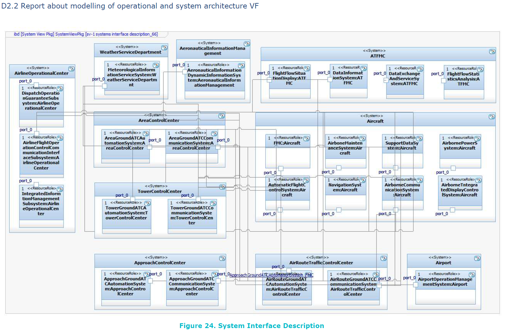

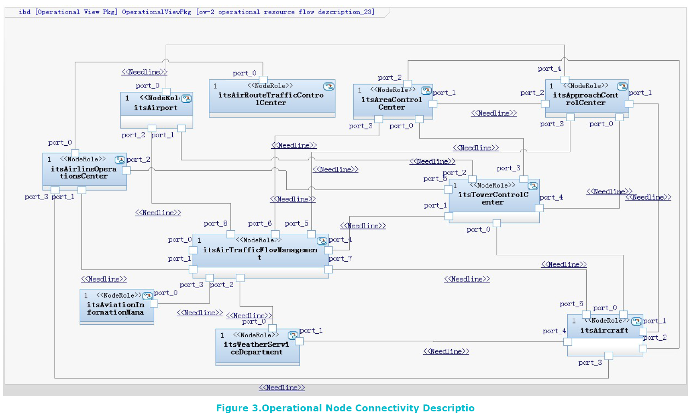

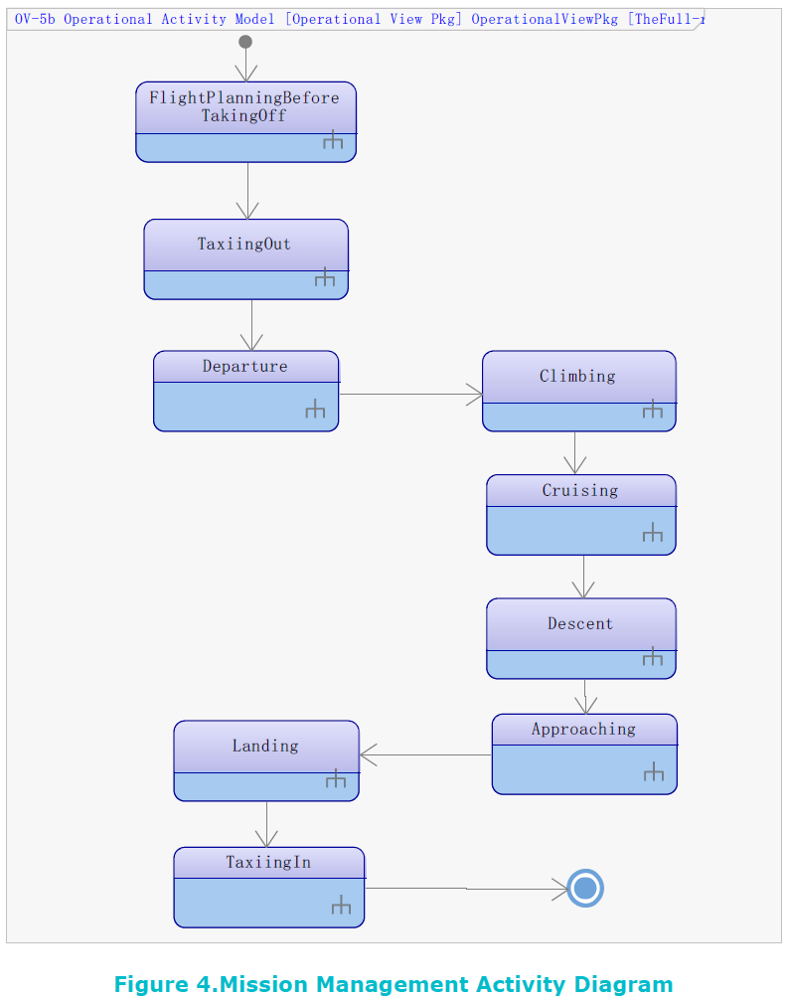

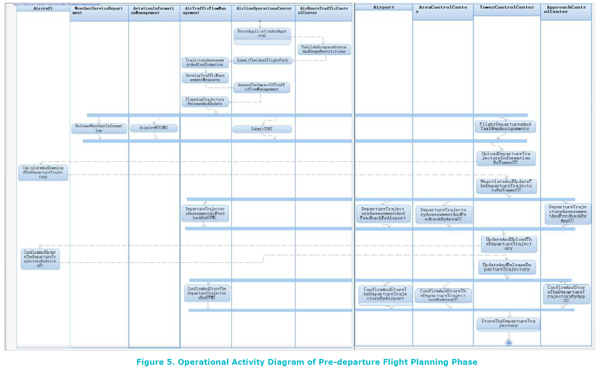

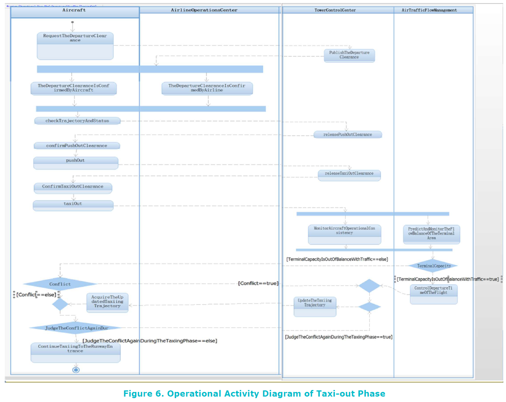

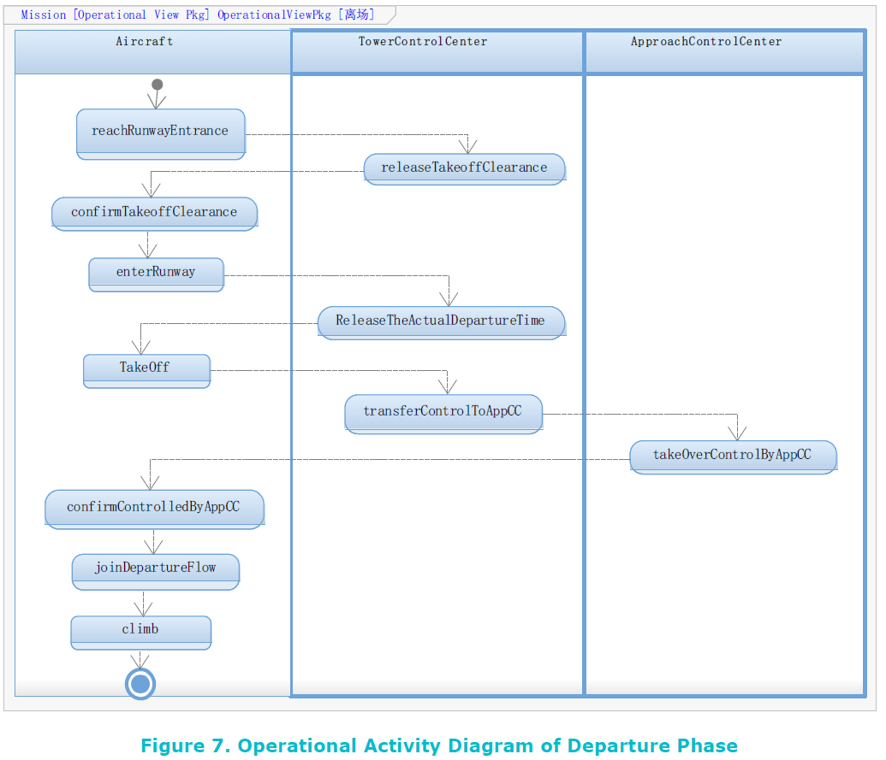

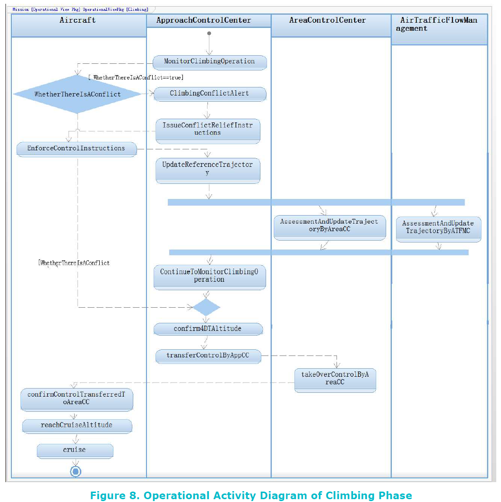

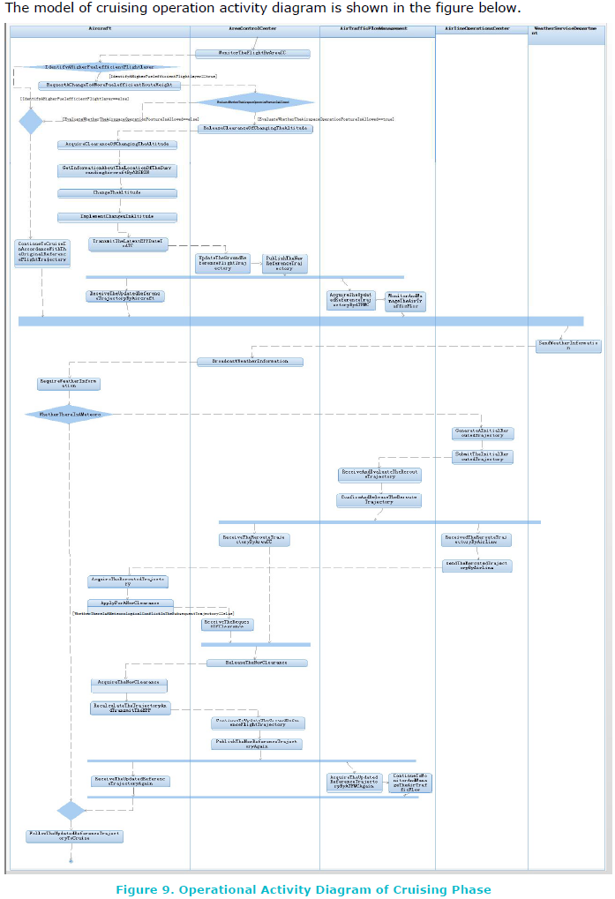

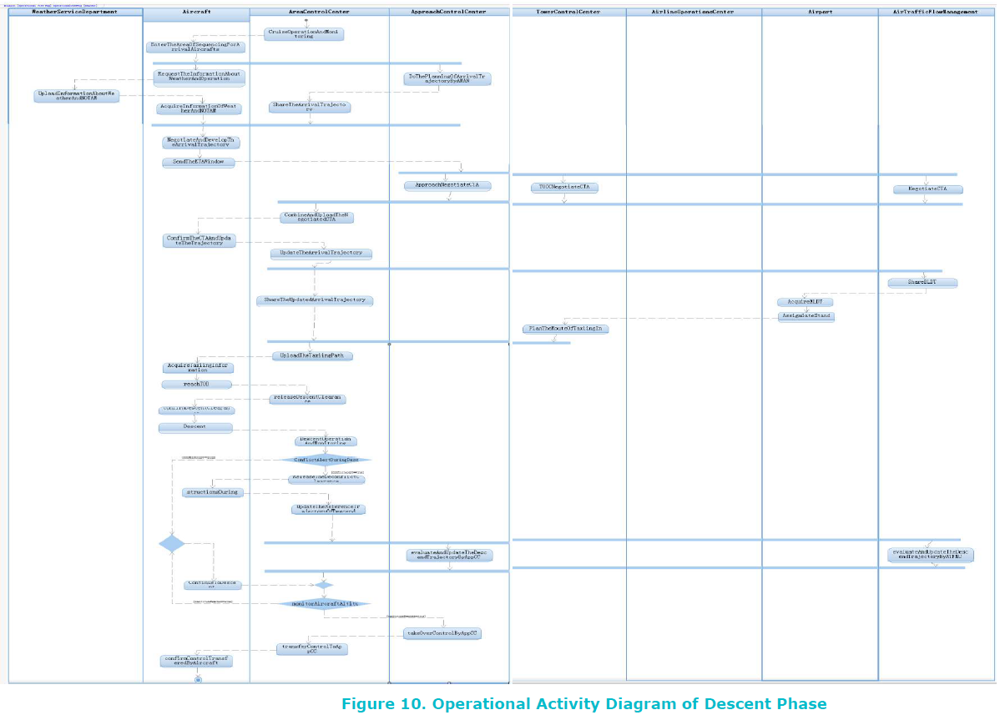

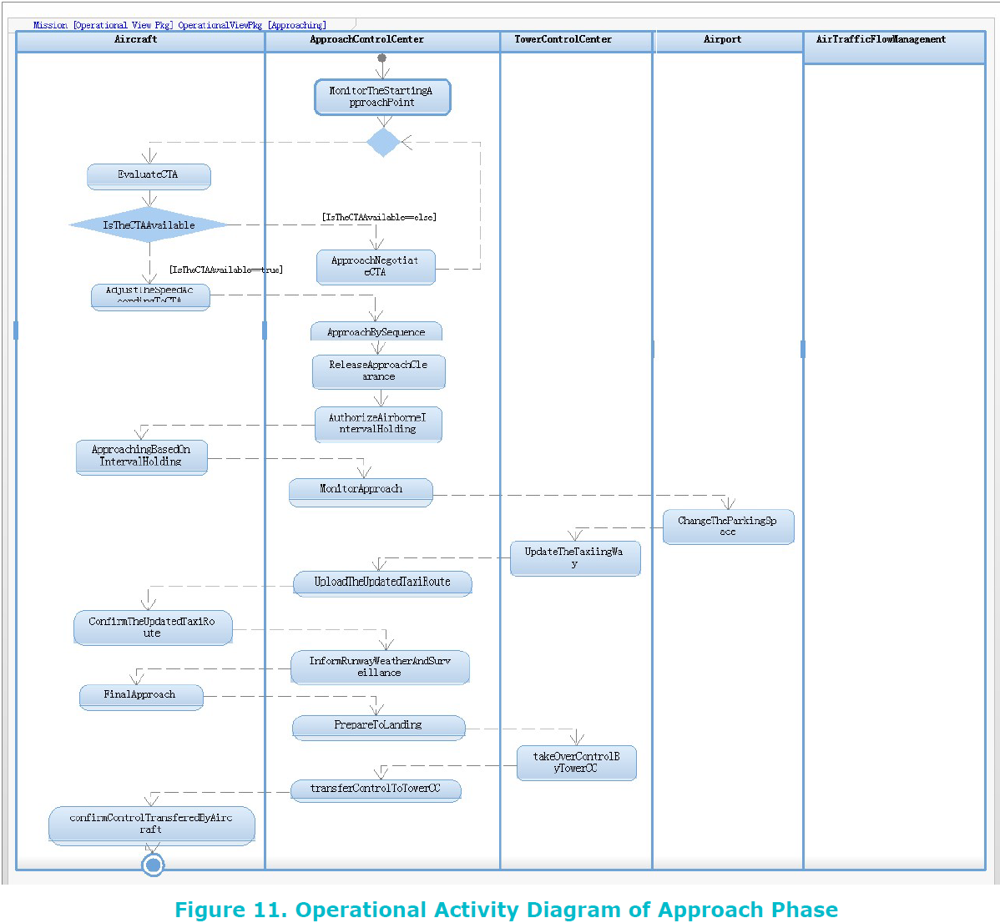

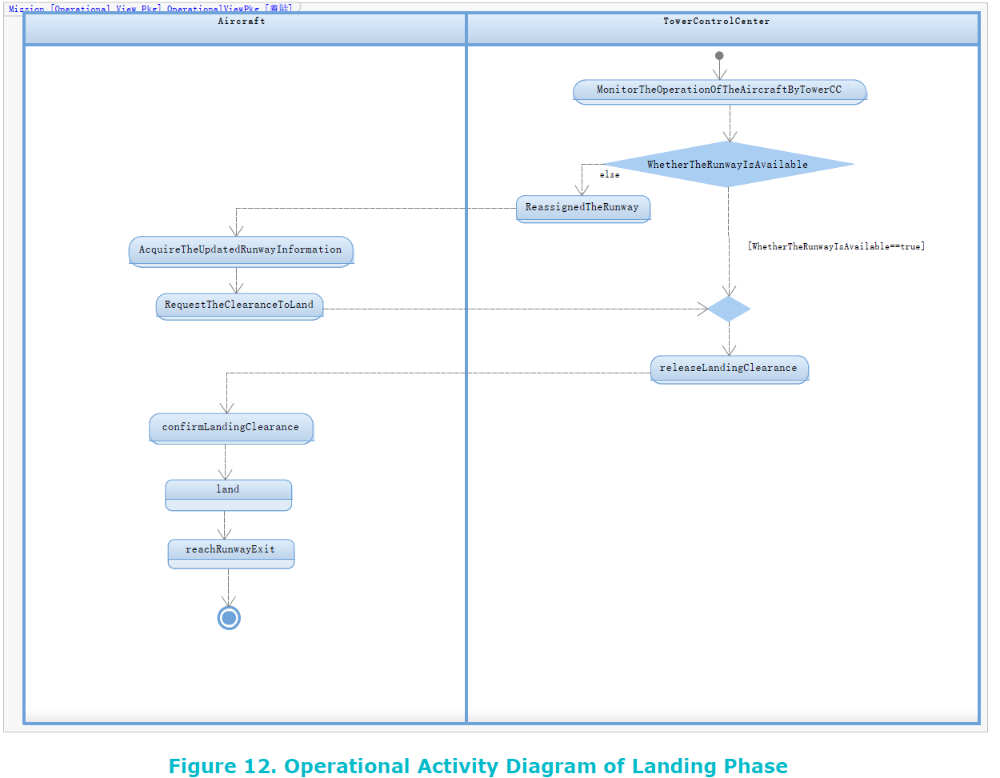

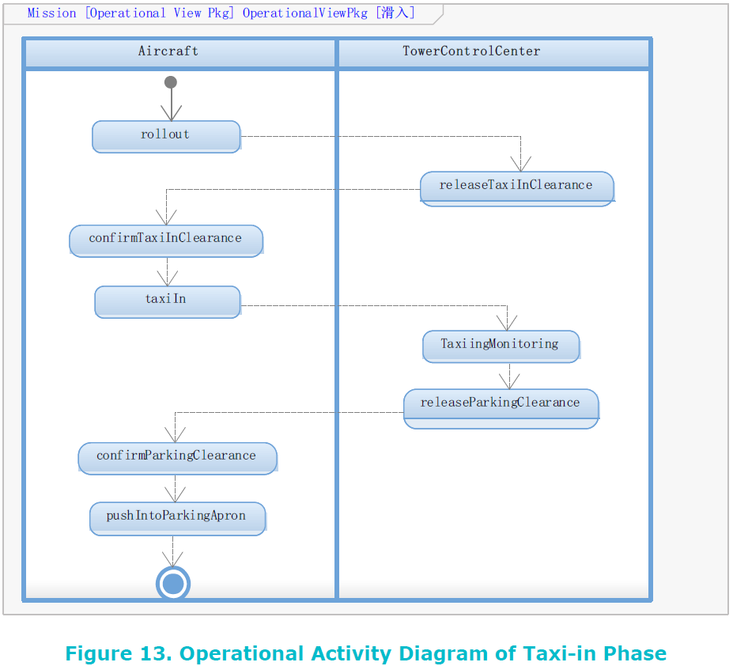