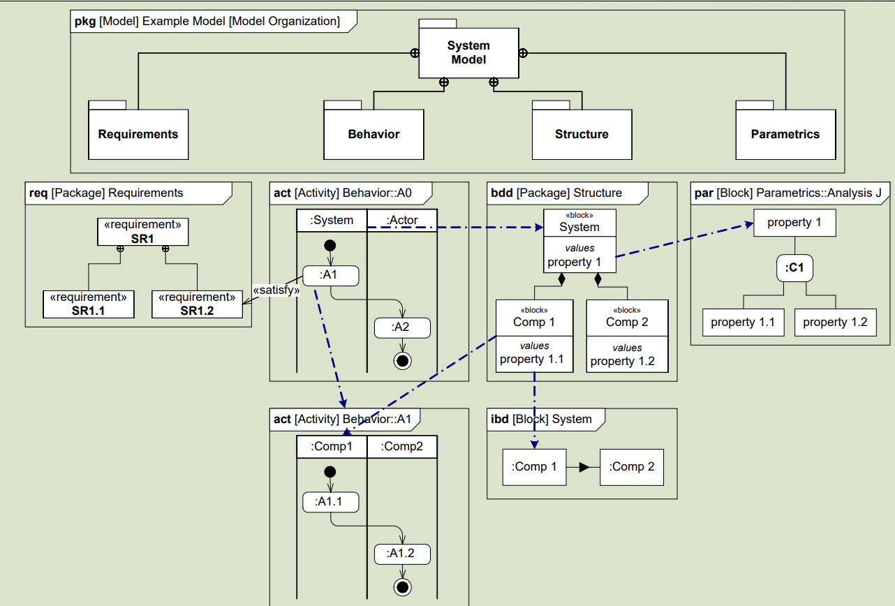
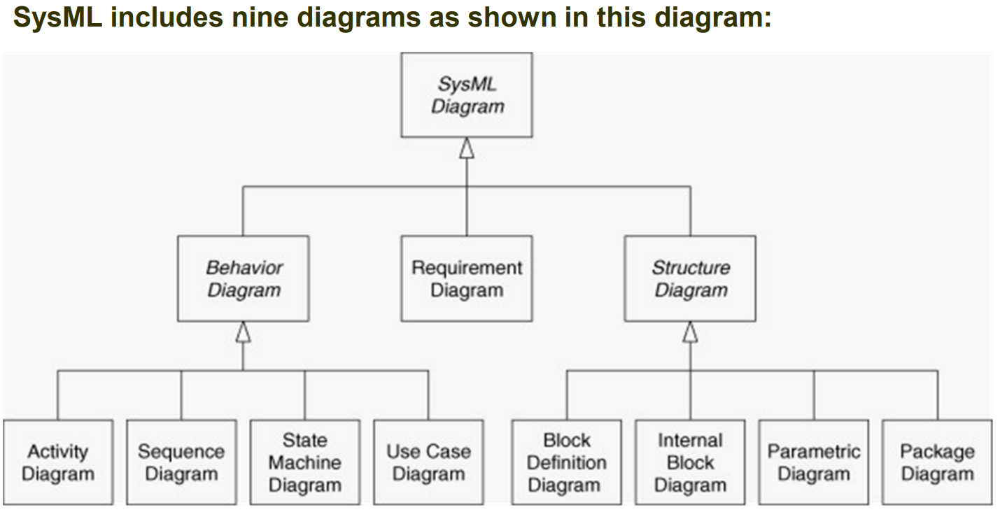

# Journal — 2026-10-19

## 19:09 — Welcome

**Recap:**

- Turn 2 begins (Turn 1 ended 10-18). Interim Report #2 is due Sun 2026-10-25, six days out. No sign-off was logged on 10-17 or 10-18; `task-board.md` was last updated 10-14 and is stale.
- Since last session: the activity diagram's comments are now SysML actions (seven phases, six new per-phase views), all committed (00e3531, "ready for hand review"). Two hand-review prints are untracked: `handwritten/2026-10-12_main.pdf` and `handwritten/2026-10-18_main.pdf`. The 10-18 print has no transcription yet.
- Still open: the scenario numbers and the compressibility decision (`experiment-scenario-numbers.md` unchanged since 10-11); the two claims are not in the Executive Summary; seven `\plantodo` notes remain in `05_experiment.tex`.

**Diagrams:** model checks clean; all 11 views unchanged, so the report was not recompiled. Usual raster-downscale warning. A second render run started by Claude overlapped the first and deleted the generated figures; they were restored from git and a single re-run confirmed all 11 unchanged. Working tree is clean apart from the two prints.

**Focus picks (Professor):**

1. Confirm the scenario numbers and decide compressibility, then re-run. Open for nine days, and Results depends on them. With six days left, this is the last chance to re-run.
2. Transcribe and apply the 10-18 hand review of the print. It is the owner's newest feedback on the whole report, and it is sitting unread six days before submission.
3. Close out the remaining Turn 1 items: put the two claims in the Executive Summary, and make line 58 of `05_experiment.tex` agree with the 18% descent figure quoted at line 97 (it still calls a single descent "the most common resolution").

## SysML

## 19:30 — Block diagrams: NAS BDD and three new domain IBDs (D-029)

- New `cameo_models/nas_block_diagrams.sysml`. Owner's choices: a composition-only BDD, and one IBD per modeled domain, reusing the existing aircraft and airspace IBDs.
- `nasBdd`: NAS → five domains → the six context-diagram systems, shown with their block types and composition lines only.
- New IBDs: `flightOperationsIbd` (8 AOC roles and decision support, 10 links, mostly [B]), `airportOperationsIbd` (13 parts, 9 links, mostly [C] from the prework AMS draft), `flightCrewIbd` (captain, FO, EFB, cabin crew, 4 links). Links drafted by Claude with evidence tags; not hand-reviewed.
- `syside check` passes. Render: 4 new views (appendix), 11 unchanged. The report compiles clean at 54 pages.
- Recorded: D-029, two new to-do Track A rows, an open question on reviewing the IBD links (two TODO(review) links, and the four unsourced airport parts that are now drawn), and a file-map row in `sysmlv2_exploration.md`.
- Next: hand-review the three IBDs on the print; decide whether any belong in the body for Interim Report #2.

## 21:20 — Hand review of the 2026-10-19 print applied (D-030)

- Transcribed `handwritten/2026-10-19_main.pdf` (ink on 16 pages) into `handwritten/2026-10-19_main.md`, with what was done for each note.
- Model: ports carry `in`/`out`, so inputs draw left and outputs right; the airspace domain has boundary ports (surveillance, flight plans, requests in; clearances out) and connections named after their content; the performance-share ports are drawn on the airspace and flight ops IBDs; `atcResolveConflict` decomposed as `ResolveConflict` (AI draft, branch per case A to D) with a new view in Section 3.4; tower issues pushback; arrival plan ATC → dispatch → crew; Prework doc reworded; scope note on the nominal activity. Found and fixed `out state`, which declared an unnamed state usage (`state` is a keyword).
- Report: A.2 heading drops RACCI; appendix landscape figures each on their own page (render script fix). 56 pages, builds clean; `syside check` passes.
- Left for the owner: the aircraft IBD trim and ADS-B path, the justification pass under the "interface used in the experiment" rule, one NAS IBD or many, aircraft state machine, GREAT comparison, the Prepare for Departure questions, Figure 11 symbols, "as modeled so far" on page 22, and the Section 3.6 text pointing at the ports.
